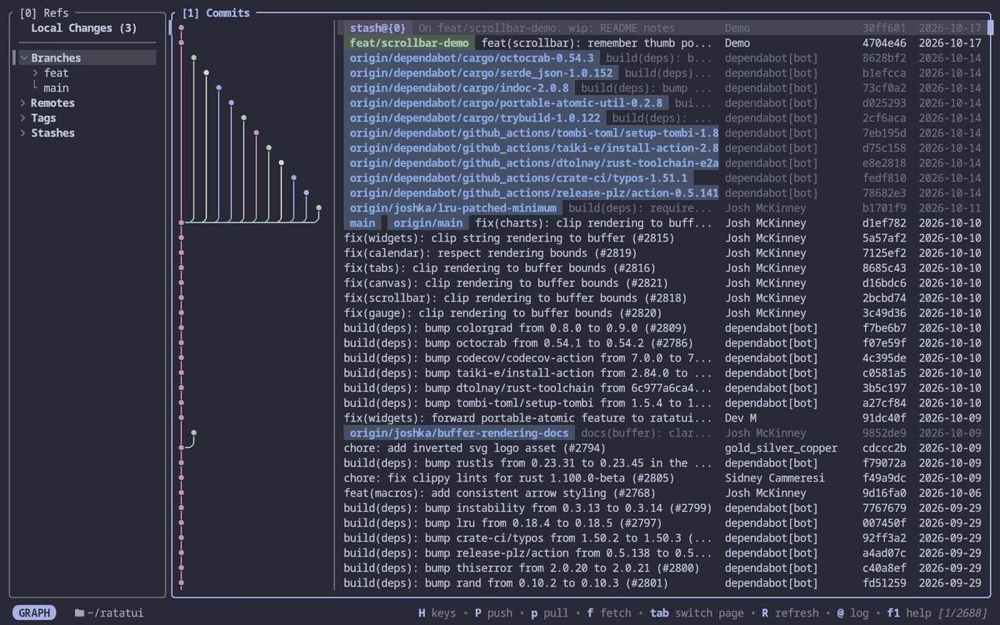
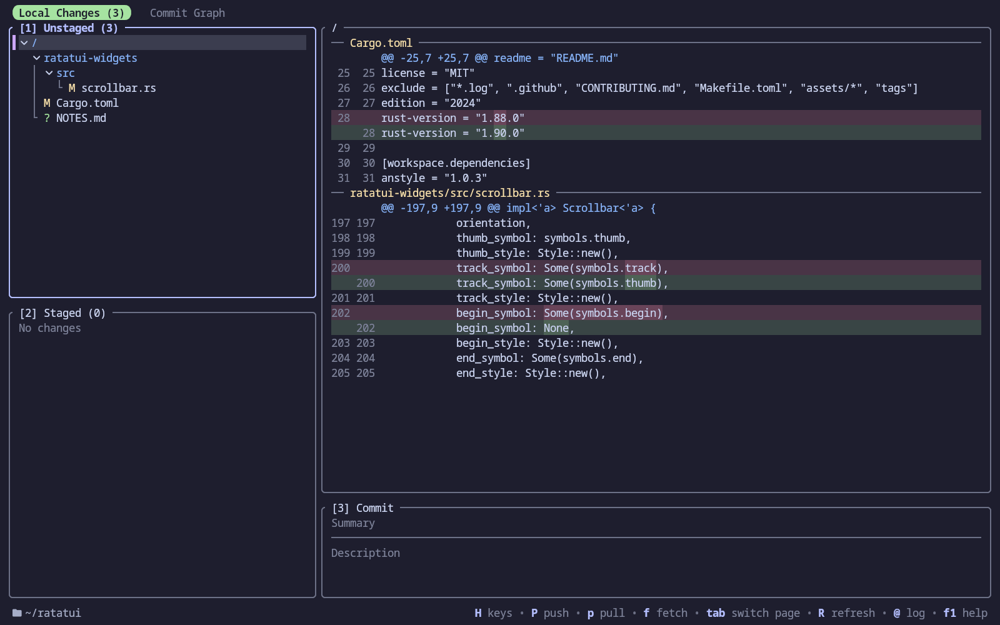
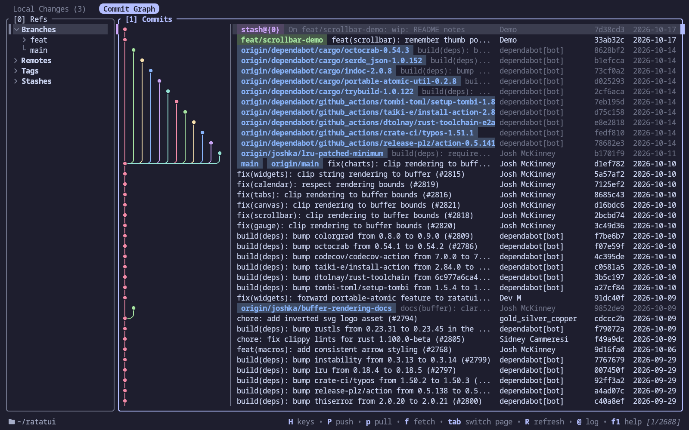
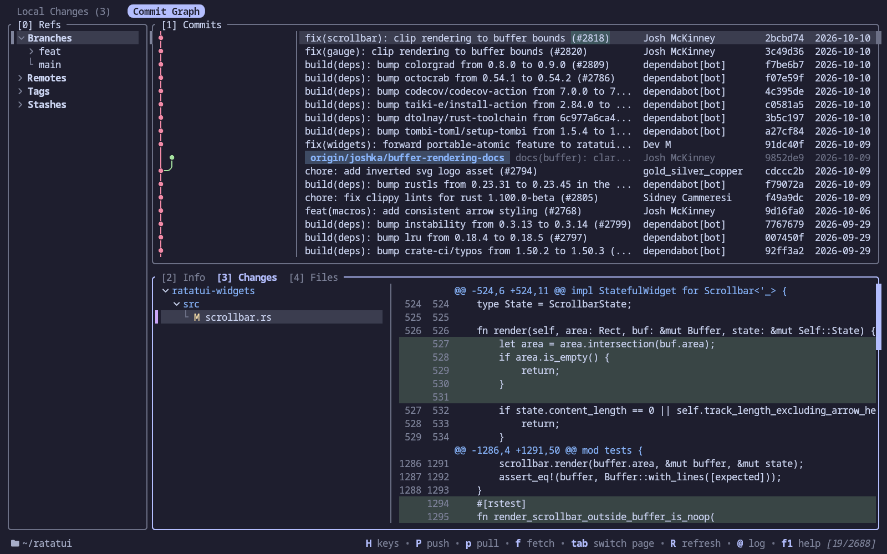
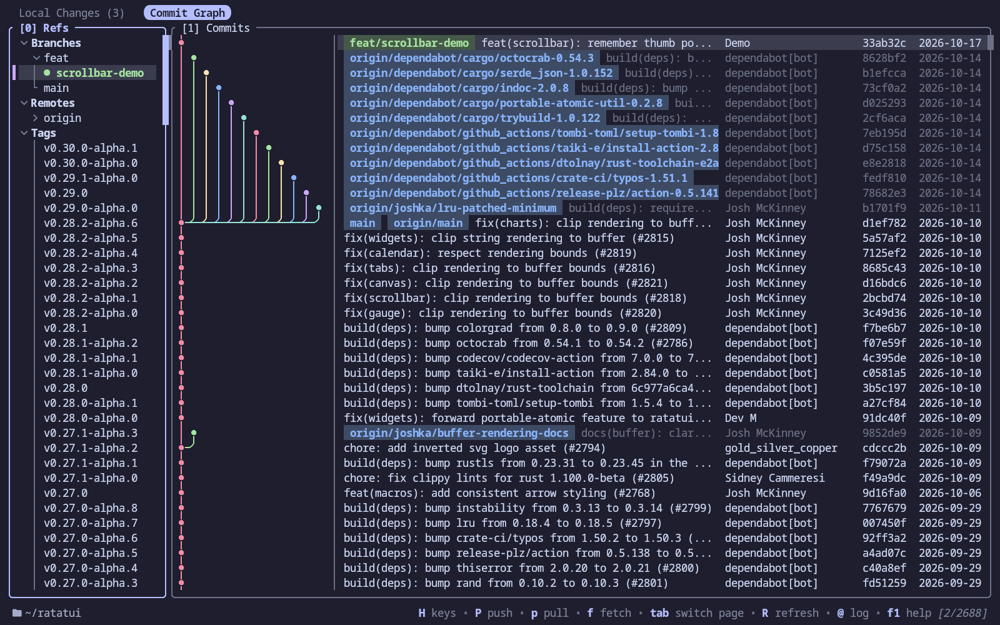
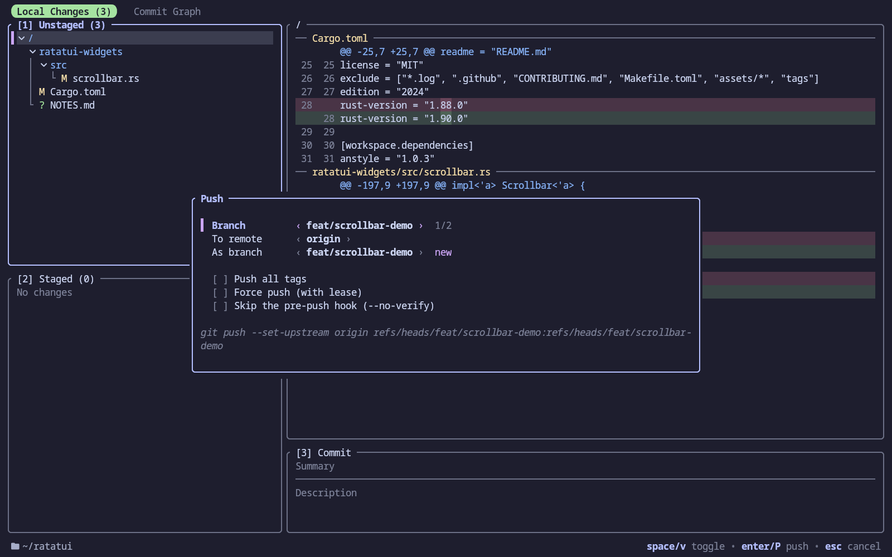

# Spoon

[](https://ratatui.rs)

A lazygit-style git client in your terminal, with a rich commit graph 🥄. Aiming to approach the UX of [fork](https://git-fork.com).



(This demo shows the [Ratatui](https://github.com/ratatui/ratatui) repository.)

## About

Spoon is a terminal UI for everyday git work: staging, committing, branching, rebasing, pushing and pulling, with keys and flows modeled on [lazygit](https://github.com/jesseduffield/lazygit) and [fork](https://git-fork.com). It is a fork of [Serie](https://github.com/lusingander/serie), and keeps Serie's commit graph, drawn as images with your terminal's image protocol, as the centerpiece.

### Features

- **Local changes**: stage and unstage files, directories, hunks or single lines; commit, amend, stash, discard, or add to `.gitignore`. Diffs highlight the words that changed within a line.
- **Commit graph**: checkout, merge, rebase, cherry-pick, squash, drop, revert, reset, or amend an older commit, all from the graph. Each command asks first in a popup showing the git command it runs.
- **Refs sidebar**, beside the commit graph: branches, remotes, tags and stashes, to create, rename, delete, diff or apply. <kbd>]</kbd> and <kbd>[</kbd> jump between sections.
- **Fetch, pull and push** run in the background, with a spinner beside the branch.
- **Conflicts**: resolve them with your merge tool or editor, then continue or abort the merge, rebase, cherry-pick or revert.
- **Open in browser**: open commits, branches, pull requests, tags and files (at the selected lines) on GitHub, GitLab, Bitbucket or Gitea/Forgejo.
- **Command log**: <kbd>@</kbd> shows every git command the app ran and its output.
- **Catppuccin Mocha** colors by default, all configurable, as are the keybindings.

## Requirements

- Git
- A terminal emulator supporting the [kitty graphics protocol](https://sw.kovidgoyal.net/kitty/graphics-protocol/) or [iTerm2 inline images](https://iterm2.com/documentation-images.html), such as kitty, Ghostty, WezTerm or iTerm2.
  - Refer to [Compatibility](./docs/src/getting-started/compatibility.md) for details.
- A [Nerd Font](https://www.nerdfonts.com/) for the icons (kitty bundles the symbols).

## Installation

### Homebrew

```
$ brew tap DanWlker/spoon
$ brew install spoon
```

### Cargo

```
$ cargo install --locked --git https://github.com/DanWlker/spoon
```

### Build from source

```
$ git clone https://github.com/DanWlker/spoon.git
$ cd spoon
$ cargo build --release
$ ./target/release/spoon
```

## Usage

Run `spoon` in your git repository.

```
$ cd <your git repository>
$ spoon
```

It opens on the commit graph; <kbd>Tab</kbd> switches to the local changes page and back. The bar at the top shows which page is open, and how many local changes there are.

### Options

```
Spoon - A lazygit-style git TUI with a rich commit graph

Usage: spoon [OPTIONS]

Options:
  -n, --max-count <NUMBER>        Maximum number of commits to render
  -p, --protocol <TYPE>           Image protocol to render graph [default: auto] [possible values: auto, iterm, kitty, kitty-unicode]
  -o, --order <TYPE>              Commit ordering algorithm [default: chrono] [possible values: chrono, topo]
  -g, --graph-width <TYPE>        Commit graph image cell width [default: auto] [possible values: auto, double, single]
  -s, --graph-style <TYPE>        Commit graph image edge style [default: rounded] [possible values: rounded, angular, curved]
      --graph-antialias           Enable antialiasing for commit graph images
      --no-graph-antialias        Disable antialiasing for commit graph images
  -i, --initial-selection <TYPE>  Initial selection of commit [default: latest] [possible values: latest, head]
  -b, --primary-branch <BRANCH>   Primary branch to keep on the leftmost column
      --local-changes             Start on the local changes page
      --minimize-sidebar          Start with the sidebar minimized
  -h, --help                      Print help
  -V, --version                   Print version
```

For details on each option, see [Command Line Options](./docs/src/getting-started/command-line-options.md).

### Keybindings

<kbd>H</kbd> shows the keys of the focused panel, and <kbd>F1</kbd> lists them all. The status bar shows the main ones as you go.

The [default keybindings](./docs/src/keybindings/index.md) can be overridden; see [Custom Keybindings](./docs/src/keybindings/custom-keybindings.md).

### Config

Config files are loaded in the following order of priority:

- `$SPOON_CONFIG_FILE`
  - If `$SPOON_CONFIG_FILE` is set but the file does not exist, an error occurs.
- `$XDG_CONFIG_HOME/spoon/config.toml`
  - If `$XDG_CONFIG_HOME` is not set, `~/.config/` is used instead.

Unset items use their defaults. For the format, see [Config File Format](./docs/src/configurations/config-file-format.md).

## Compatibility

The commit graph is drawn with one of these image protocols:

- [Inline Images Protocol (iTerm2)](https://iterm2.com/documentation-images.html)
- [Terminal graphics protocol (kitty)](https://sw.kovidgoyal.net/kitty/graphics-protocol/), in both its default mode and its [Unicode placeholder](https://sw.kovidgoyal.net/kitty/graphics-protocol/#unicode-placeholders) mode.

tmux works only with the kitty Unicode placeholder protocol (`--protocol kitty-unicode`). Sixel, other terminal multiplexers and Windows are not supported.

## Screenshots

Local changes, with the words changed in each line highlighted:



The commit graph:



A commit's changes:



Branches, remotes and tags in the sidebar:



Git commands confirm in a popup showing what they run:



## Credits

Spoon is a fork of [Serie](https://github.com/lusingander/serie) by [Kyosuke Fujimoto](https://github.com/lusingander). It takes its keys and flows from [lazygit](https://github.com/jesseduffield/lazygit) and [fork](https://git-fork.com).

## License

MIT
