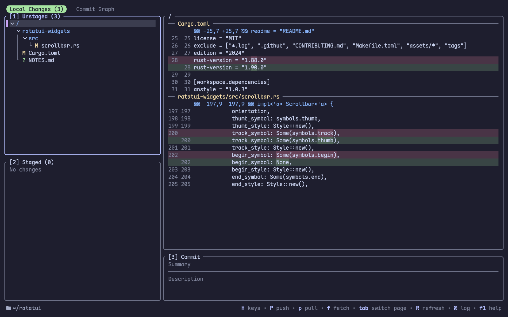
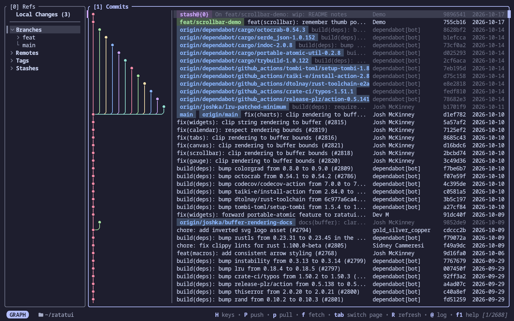
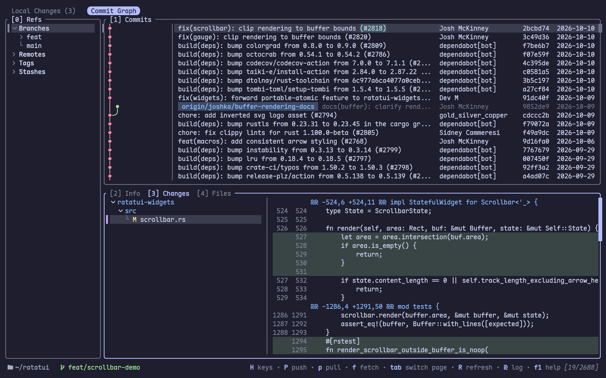
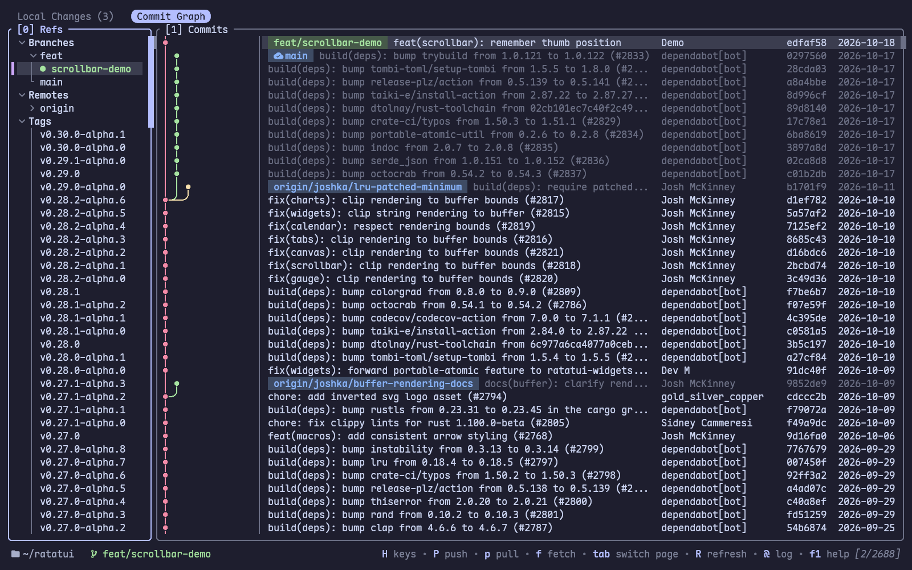
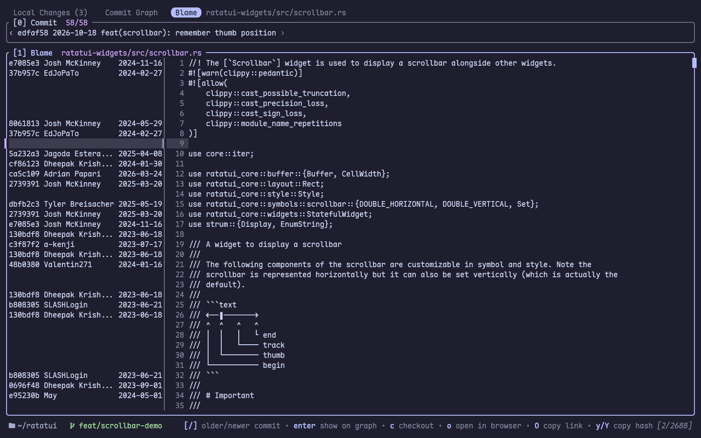
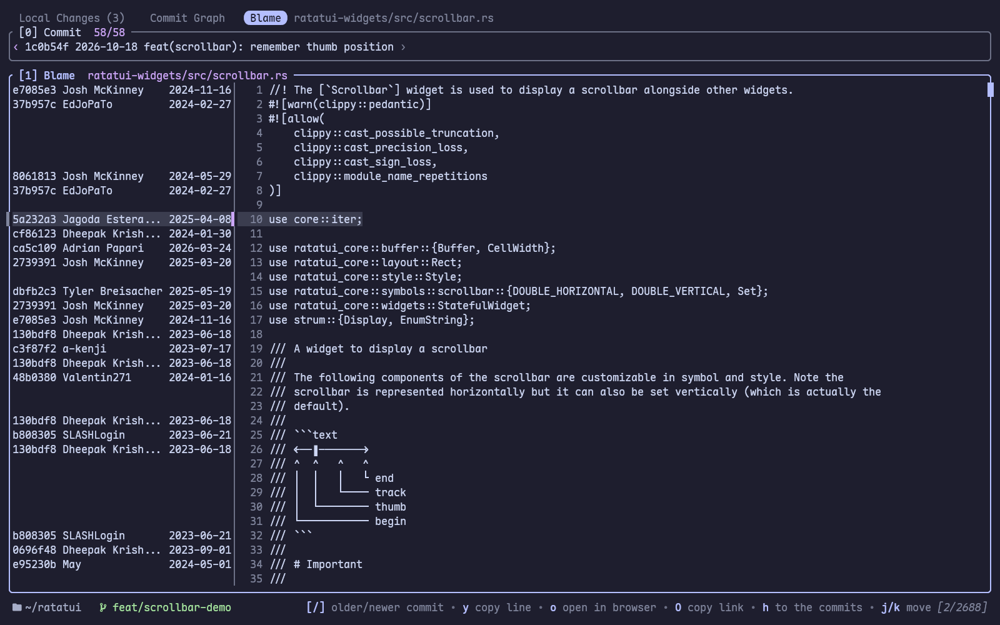
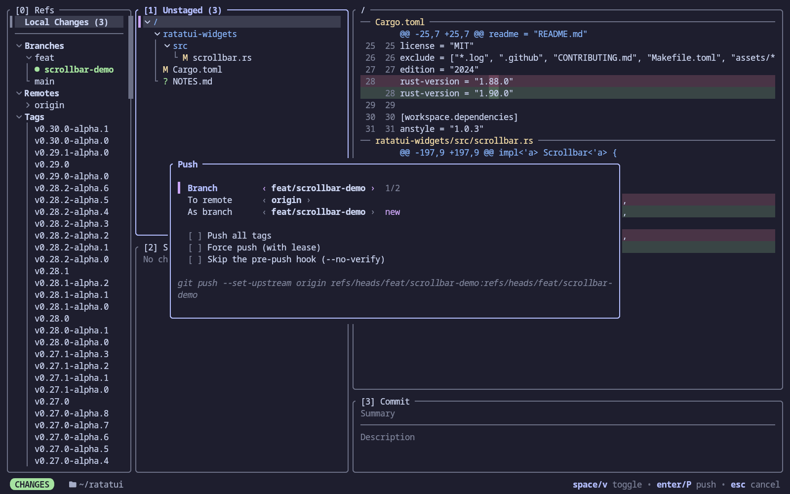

# Screenshots

Local changes, with the words changed in each line highlighted:

The commit graph:

A commit's changes:

Branches, remotes and tags in the sidebar:

Who last changed each line of a file, stepping back through the commits changing it:

The commits changing a file, with its changes in each:

Git commands confirm in a popup showing what they run:

These show the [ratatui/ratatui](https://github.com/ratatui/ratatui) repository.
