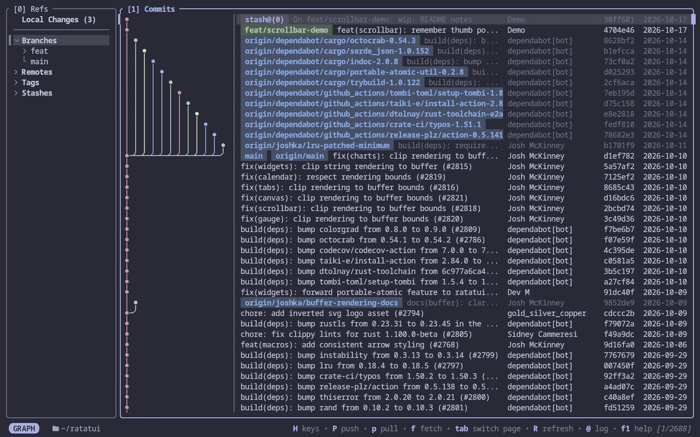

# Introduction

**Spoon** is a lazygit-style git client in your terminal, with a rich commit graph drawn as images with your terminal's image protocol.

(This demo shows the [Ratatui](https://github.com/ratatui/ratatui) repository.)

## About

Spoon is a terminal UI for everyday git work: staging, committing, branching, rebasing, pushing and pulling, with keys and flows modeled on [lazygit](https://github.com/jesseduffield/lazygit) and [fork](https://git-fork.com). It is a fork of [Serie](https://github.com/lusingander/serie), and keeps Serie's commit graph as the centerpiece.

- **Local changes**: stage and unstage files, directories, hunks or single lines; commit, amend, stash, discard, or add to `.gitignore`.
- **Commit graph**: checkout, merge, rebase, cherry-pick, squash, drop, revert, reset, or amend an older commit, each asking first in a popup showing the git command it runs.
- **Refs sidebar**: branches, remotes, tags and stashes, to create, rename, delete, diff or apply.
- **Fetch, pull and push** in the background, **conflicts** resolved with your merge tool or editor, **blame** and a **timeline** of a file, and a **command log** of every git command run.

---

_Built with Rust and [ratatui](https://github.com/ratatui/ratatui)._  
_Spoon is available on [GitHub](https://github.com/DanWlker/spoon) under the MIT license._
